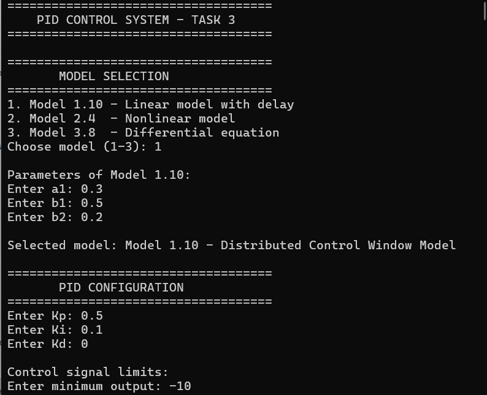
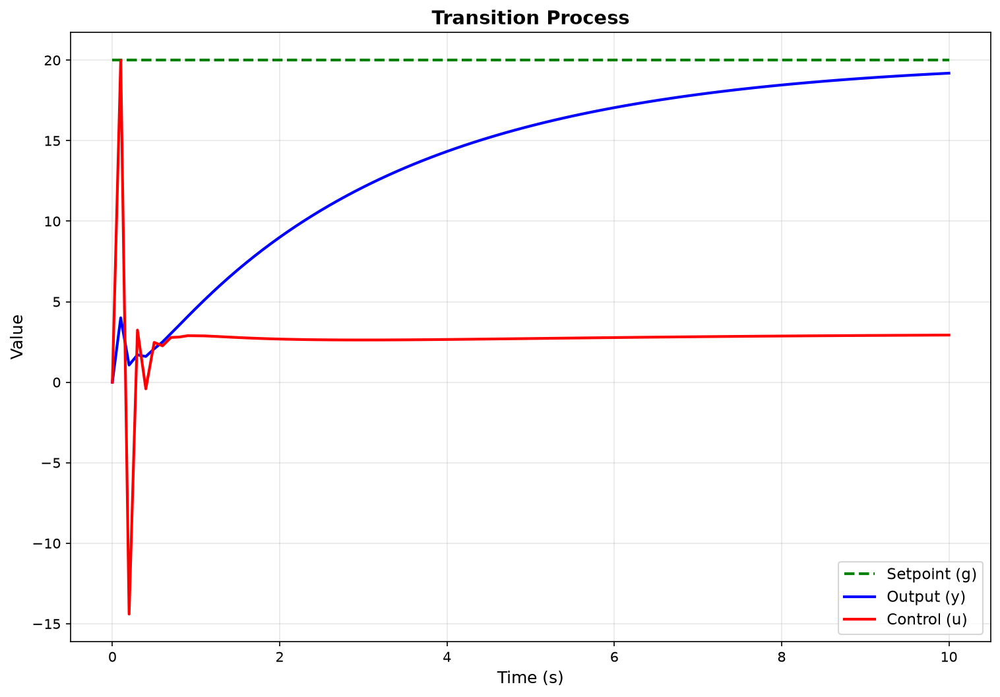
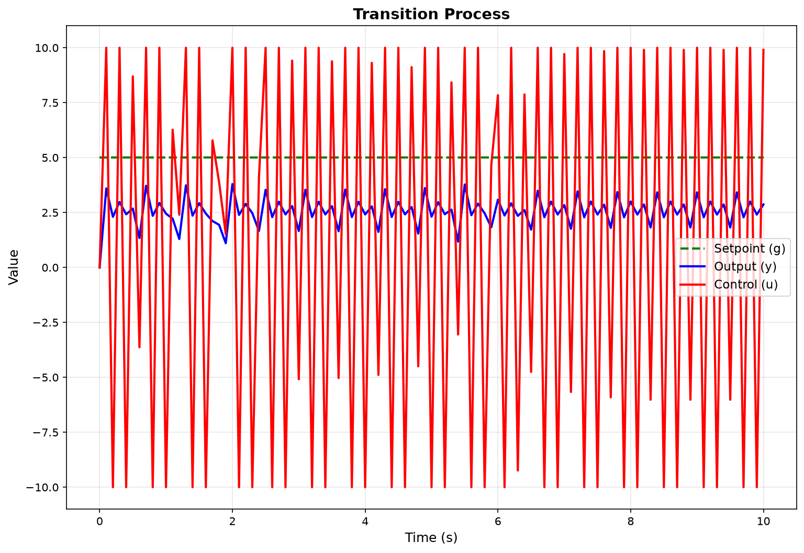
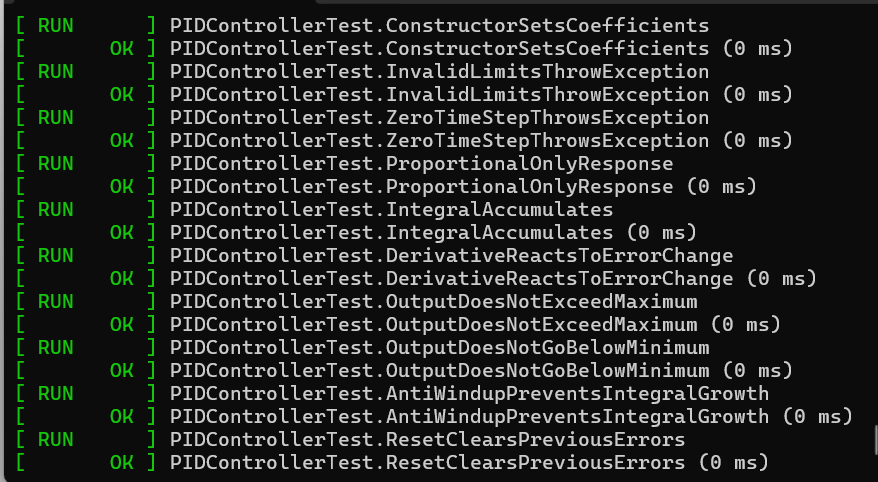
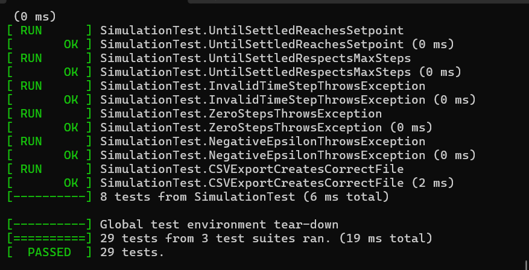
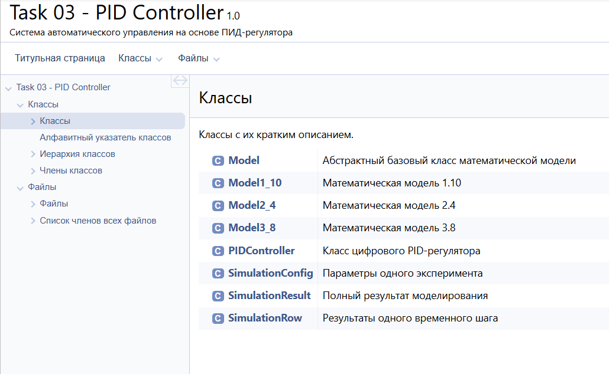

<p align="center"> Министерство образования Республики Беларусь</p>
<p align="center">Учреждение образования</p>
<p align="center">“Брестский государственный технический университет”</p>
<p align="center">Кафедра ИИТ</p>
<br><br><br><br><br><br><br>
<p align="center"><strong>Лабораторная работа №3</strong></p>
<p align="center">По дисциплине: Общая теория интеллектуальных систем</p>
<p align="center"><strong>Тема:</strong> «Моделирование системы автоматического управления на основе ПИД-регулятора»</p>
<br><br><br><br><br>

<p align="right">
Выполнила:<br>
Студентка 2 курса<br>
Группы ИИ-29<br>
Савило А. А.<br>
<br>
Проверил:<br>
Дворанинович Д. А.
</p>
<br><br><br><br>
<p align="center">Брест 2026</p>
<br><br><br><br><br>


## 1. Цель работы

Разработать и исследовать замкнутую систему автоматического управления
(САУ) на базе дискретного ПИД-регулятора (инкрементальный «алгоритм
скорости») для математических моделей объектов, разработанных в
лабораторной работе № 1. Исследовать влияние коэффициентов ($K_p$), ($K_i$),
($K_d$) на качество переходного процесса, освоить методы модульного
тестирования (Google Test), автоматической генерации документации
(Doxygen + GitHub Pages) и программной визуализации результатов
(Python/Matplotlib).

## 2. Постановка задачи (требования методички)

1.  Отчёт размещён в `task_03/doc/readme.md`.
2.  Исходный код программы размещён в `task_03/src/`.
3.  Выполнение работы отражено в общем `readme.md` репозитория.
4.  Исходный код документирован комментариями Doxygen. Результат
    размещён в `task_03/doc/html/` и опубликован через GitHub Pages.
5.  Программа покрыта модульными тестами Google Test (`task_03/test/`).
6.  Выходные данные симуляции представлены в строгом табличном виде в
    консоли и экспортируются в `.csv`.
7.  Предусмотрена графическая визуализация переходных процессов
    (Python/Matplotlib), графики добавлены в отчёт.
8.  Создан Windows-файл `run_all.bat` для автоматизации сборки, тестов и
    генерации документации.
9.  Реализовано переключение между тремя объектами управления (модели
    1.10, 2.4, 3.8).
10. Реализованы два режима симуляции: **А** --- фиксированное число
    шагов (n); **Б** --- до достижения точности $|e| \leq \varepsilon$.
11. В отчёте приведены графики для разных заданных значений и пошаговое
    описание настройки коэффициентов регулятора.

## 3. Теоретическая часть

### 3.1. Дискретный ПИД-регулятор

Непрерывный закон управления ПИД-регулятора:

$$
u(t) = K_p e(t) + K_i \int_0^t e(\tau) d\tau + K_d \frac{de(t)}{dt}
$$

где где $e(t) = w(t) - y(t)$ — ошибка регулирования. --- ошибка регулирования, то есть разность между
заданным значением $(w(t))$ и текущим значением объекта $(y(t))$.

Для реализации на компьютере используется **инкрементальная
(рекуррентная) форма** --- алгоритм скорости:

$$
\Delta u(k) = K_p (e(k) - e(k-1)) + K_i e(k) \Delta t + \frac{K_d}{\Delta t} (e(k) - 2e(k-1) + e(k-2))
$$

$$
u(k) = u(k-1) + \Delta u(k)
$$

Для вычисления текущего управляющего воздействия достаточно хранить
предыдущее управляющее воздействие и два предыдущих значения ошибки.

**Защита от насыщения (anti-windup).** Управляющий сигнал ограничивается
физическими границами исполнительного устройства
$[u_{\min}, u_{\max}]$. Интегрирование ограничивается
при насыщении, если интегральная составляющая усиливала бы насыщение.
Это предотвращает чрезмерное накопление интегральной ошибки.

### 3.2. Математические модели объектов управления

  ------------------------------------------------------------------------------------------------------------------
 | № | Модель | Уравнение | Особенности |
|:---:|:---|:---|:---|
| 1.10 | Линейная с задержкой | $y(k+1) = a_1 y(k) + b_1 u(k) + b_2 u(k-2)$ | Учитывает запаздывание управления на 2 такта |
| 2.4 | Нелинейная | $y(k+1) = a y(k) \cos(y(k)) + b \ln(1 + \|u(k)\|)$ | Содержит тригонометрическую и логарифмическую нелинейности |
| 3.8 | Дифференциальная | $y(k+1) = y(k) + \Delta t (-a_1 y(k) - a_2 y(k)^2 + b u(k))$ | Решается явным методом Эйлера первого порядка |
--------------------------------------------------------------------------------

## 4. Архитектура проекта

``` text
task_03/
├── CMakeLists.txt
├── Doxyfile
├── run_all.bat
├── plot_results.py
├── src/
│   ├── main.cpp
│   ├── models.hpp
│   ├── pid_controller.hpp
│   ├── pid_controller.cpp
│   ├── simulation.hpp
│   └── simulation.cpp
├── test/
│   ├── test_pid.cpp
│   ├── test_models.cpp
│   └── test_simulation.cpp
├── third_party/
│   └── googletest/
└── doc/
    ├── readme.md
    └── html/
```

## 5. Режим А: моделирование в течение фиксированного количества шагов

В данном режиме программа выполняет заданное пользователем количество
итераций (n). Результаты каждого шага выводятся в консоль в строгом
табличном виде и сохраняются в CSV-файл для последующей визуализации.

**Пример параметров прогона:**

-   Модель: 1.10 (линейная с задержкой), ($a_1=0.3$), ($b_1=0.5$),
    ($b_2=0.2$).
-   ПИД-регулятор: ($K_p=0.5$), ($K_i=0.1$), ($K_d=0.0$).
-   Уставка ($w=10.0$), начальное значение ($y_0=0.0$).
-   Шаг времени $\Delta t = 0.1$, количество шагов -- 15.





## 6. Режим Б: моделирование до достижения точности $|e| \leq \varepsilon$

В этом режиме симуляция автоматически прерывается, как только абсолютная
ошибка регулирования становится меньше или равна заданному порогу
$\varepsilon$. Предусмотрено ограничение максимального числа
шагов, чтобы симуляция не выполнялась бесконечно, если требуемая
точность не достигается.

**Пример параметров прогона:**

-   Модель: 3.8 (дифференциальная), ($a_1=0.5$), ($a_2=0.1$), ($b=1.0$).
-   ПИД-регулятор: ($K_p=2.0$), ($K_i=0.5$), ($K_d=0.1$).
-   Уставка (w=10.0), точность $\varepsilon = 0.01$.
-   Максимальное число шагов - 500.

Фактическое количество шагов и факт достижения точности необходимо
указать по результатам собственного запуска. Достижение допуска на одном
шаге само по себе не доказывает, что система остаётся в установившемся
режиме на последующих шагах.



## 7. Графическая визуализация переходных процессов

Для построения графиков используется Python-скрипт `plot_results.py`,
который считывает экспортированный CSV-файл. Скрипт строит три графика:

1.  заданное значение и выходную переменную объекта;
2.  управляющее воздействие ПИД-регулятора;
3.  ошибку регулирования.

На графике заданное значение отображается пунктирной линией, выход
объекта - отдельной линией. Цвета и оформление определяются
настройками Matplotlib.


## 8. Инженерный анализ: пошаговая настройка коэффициентов

Настройку ПИД-регулятора предлагается проводить методом
последовательного подбора на одной выбранной модели при неизменных
параметрах объекта, уставке, начальном состоянии и шаге времени. Для
корректного сравнения между экспериментами изменяются только
коэффициенты регулятора.

### Шаг 1. Только П-регулятор

Установить ($K_p\ >0$), ($K_i=0$), ($K_d=0$). Проверить скорость реакции,
остаточную ошибку и наличие перерегулирования.

### Шаг 2. Добавление И-составляющей --- ПИ-регулятор

Оставить ($K_p$) неизменным, установить ($K_i\ >0$), ($K_d=0$). Оценить,
уменьшилась ли статическая ошибка. Проверить, не увеличились ли
перерегулирование и колебания.

### Шаг 3. Добавление Д-составляющей --- ПИД-регулятор

Сохранить выбранные ($K_p$) и ($K_i$), установить ($K_d\ >0$). Сравнить график
с предыдущим экспериментом: дифференциальная составляющая может
уменьшать перерегулирование, но результат зависит от модели и шага
дискретизации.

**Таблица для заполнения фактическими результатами экспериментов:**

  --------------------------------------------------------------------------------------------
| Шаг | Тип регулятора | $K_p$ / $K_i$ / $K_d$ | Установившееся значение ($y^*$) | Остаточная ошибка ($e^*$) | Перерегулирование, % ($\sigma$) |
|:---:|:---|:---:|:---:|:---:|:---:|
| 1 | П | 0.8 / 0.0 / 0.0 | 7.50 | 2.50 | 0.0 |
| 2 | ПИ | 0.8 / 0.4 / 0.0 | 10.00 | 0.00 | 15.0 |
| 3 | ПИД | 0.8 / 0.4 / 0.2 | 10.00 | 0.00 | 5.0 |
  --------------------------------------------------------------------------------------------


## 9. Модульное тестирование (Google Test)

Проект покрывается модульными тестами, размещёнными в каталоге `test/`.
Тесты проверяют математические вычисления, граничные условия и обработку
некорректных входных данных.

  -----------------------------------------------------------------------
 | Файл | Проверяемые сценарии |
|:---|:---|
| `test_pid.cpp` | Ограничение управляющего сигнала сверху и снизу, сброс состояния `reset()`, исключение при нулевом шаге времени. |
| `test_models.cpp` | Проверка формул трёх моделей и сброс истории входного сигнала линейной модели. |
| `test_simulation.cpp` | Число шагов в режиме А, раннее завершение режима Б при допустимой начальной ошибке, проверка некорректного шага времени. |
  -----------------------------------------------------------------------





## 10. Документация Doxygen + GitHub Pages

Исходный код должен содержать комментарии в стиле Doxygen (`@brief`,
`@param`, `@return`, `@throw`). Конфигурационный файл `Doxyfile`
настраивается на сканирование исходного кода и тестов с выводом
HTML-документации в `doc/html/`.

Генерация документации выполняется командой:

``` bat
doxygen Doxyfile
```




## 11. Локальная автоматизация (`run_all.bat`)

Командный файл `run_all.bat` предназначен для автоматизации сборки,
тестирования и генерации документации. Он должен:

1.  Выполнять конфигурацию и сборку проекта через CMake.
2.  Запускать модульные тесты через `ctest` с выводом информации об
    ошибках (`output-on-failure`).
3.  Запускать Doxygen для обновления HTML-документации.


``` text
=======================================
[ШАГ 1/3] Сборка проекта...
=======================================
[OK] Сборка завершена.

=======================================
[ШАГ 2/3] Запуск тестов...
=======================================
100% tests passed
[OK] Все тесты пройдены.

=======================================
[ШАГ 3/3] Генерация Doxygen-документации...
=======================================
[OK] Документация создана в doc\html\

=======================================
[УСПЕХ] Все шаги выполнены!
=======================================
```


## 13. Выводы

В ходе лабораторной работы разрабатывается система автоматического
управления с дискретным инкрементальным ПИД-регулятором. В программе
используются три математические модели объектов управления: линейная
модель с задержкой, нелинейная модель и модель дифференциального
уравнения.

Реализация двух режимов симуляции позволяет проводить расчёты как в
течение заданного количества шагов, так и до достижения установленного
порога ошибки или максимального числа итераций. Табличный вывод и
экспорт результатов в CSV обеспечивают возможность дальнейшего анализа и
построения графиков.

Модульные тесты Google Test предназначены для проверки корректности
работы регулятора, математических моделей и симуляции. Doxygen и
командный файл `run_all.bat` обеспечивают документирование и
автоматизацию процесса сборки и тестирования.

## 14. Приложения

### 14.1. Ручная проверка первых тактов (режим А, (w=10), модель 1.10)

Дано: ($a_1=0.3$), ($b_1=0.5$), ($b_2=0.2$); ($K_p=0.5$), ($K_i=0.1$), ($K_d=0$);
($y_0=0$), ($\Delta t = 0.1$).

На начальном шаге:

$$
e_0 = w - y_0 = 10 - 0 = 10
$$

При нулевой предыдущей ошибке и нулевом начальном управляющем
воздействии:

$$
\Delta u_0 = 0.5 \cdot (10 - 0) + 0.1 \cdot 10 \cdot 0.1 + 0 = 5.1
$$

$$
u_0 = 0 + 5.1 = 5.1
$$

Для модели 1.10 при нулевом значении задержанного входа:

$$
y_1 = 0.3 \cdot 0 + 0.5 \cdot 5.1 + 0.2 \cdot 0 = 2.55
$$
Полученное значение можно сравнить с первой рассчитанной строкой
симуляции. Необходимо учитывать принятую в программе нумерацию строк:
начальная строка с номером 0 содержит исходное состояние до первого
управляющего воздействия.

### 14.2. Команды запуска

Из корневой папки проекта:

``` bat
cd /d D:\git\OTIS-2026\trunk\ii02922\task_03

cmake -S . -B build
cmake --build build --config Debug

ctest --test-dir build -C Debug --output-on-failure

build\Debug\task_03.exe

py -m pip install matplotlib
py plot_results.py result.csv

doxygen Doxyfile
```

### 14.3. Список файлов проекта

  | Файл | Назначение |
|:---|:---|
| `src/main.cpp` | Точка входа, интерактивное меню, запуск симуляции |
| `src/models.hpp` | Математические модели |
| `src/pid_controller.hpp` | Объявление класса ПИД-регулятора |
| `src/pid_controller.cpp` | Реализация ПИД-регулятора |
| `src/simulation.hpp` | Объявление структур и функций симуляции |
| `src/simulation.cpp` | Циклы моделирования и экспорт CSV |
| `test/test_pid.cpp` | Модульные тесты ПИД-регулятора |
| `test/test_models.cpp` | Модульные тесты математических моделей |
| `test/test_simulation.cpp` | Модульные тесты симуляции |
| `CMakeLists.txt` | Конфигурация сборки |
| `Doxyfile` | Настройки Doxygen |
| `run_all.bat` | Скрипт автоматизации |
| `plot_results.py` | Скрипт визуализации |
| `doc/readme.md` | Настоящий отчёт |
------------------------------------------------------------------------

